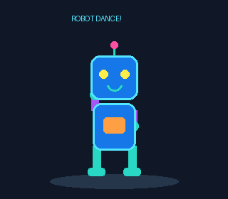

# Hi 👋, I'm Rishi

### Automation & Robotics Engineering | Robotics Developer

A passionate Robotics and Automation Engineering student building intelligent machines.

- 🤖 Interested in robotics, automation, and intelligent machines.
- 🌱 Exploring ROS 2, robot manipulation, and motion control.
- 🐍 Working with Python, computer vision, and embedded systems.
- ⚙️ Interested in control engineering, simulation, and mechanical design.

### Connect with me

&nbsp;&nbsp;
&nbsp;&nbsp;

 

---

### Languages and Tools

  
  

---

### GitHub Statistics

<picture>
  <source media="(prefers-color-scheme: dark)" srcset="https://github-readme-stats.vercel.app/api?username=RISHI-747&show_icons=true&hide_border=true&bg_color=0D1117&title_color=58A6FF&text_color=C9D1D9&icon_color=58A6FF">
  <source media="(prefers-color-scheme: light)" srcset="https://github-readme-stats.vercel.app/api?username=RISHI-747&show_icons=true&hide_border=true&bg_color=FFFFFF&title_color=0969DA&text_color=24292F&icon_color=0969DA">
  
</picture>

<picture>
  <source media="(prefers-color-scheme: dark)" srcset="https://github-readme-stats.vercel.app/api/top-langs/?username=RISHI-747&layout=compact&hide_border=true&bg_color=0D1117&title_color=58A6FF&text_color=C9D1D9">
  <source media="(prefers-color-scheme: light)" srcset="https://github-readme-stats.vercel.app/api/top-langs/?username=RISHI-747&layout=compact&hide_border=true&bg_color=FFFFFF&title_color=0969DA&text_color=24292F">
  
</picture>

  <i>Building, learning, and bringing robots to life.</i>

